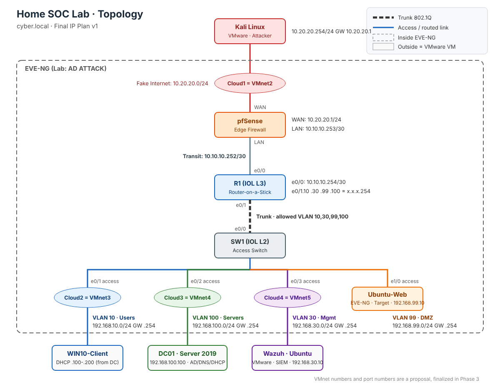

# Home SOC Lab

A home lab that simulates a small enterprise network (`cyber.local`). I use it to practice the full cycle: **attack → logs → detection → investigation → incident report**.

It's built in **EVE-NG** (Cisco IOL router and switch, pfSense) and **VMware Workstation** (Active Directory, a Windows client, Kali Linux, and a Wazuh SIEM (planned).

> Status: 🚧 In progress. Network phase complete (VLANs, Inter-VLAN routing, DHCP relay).

---

## Architecture



| Segment       | VLAN | Subnet            | Gateway          | Hosts                          |
|---------------|------|-------------------|------------------|--------------------------------|
| Fake Internet | -    | 10.20.20.0/24     | -                | Kali (attacker), pfSense WAN   |
| Transit       | -    | 10.10.10.252/30   | -                | pfSense LAN `.253`, R1 `.254`  |
| Users         | 10   | 192.168.10.0/24   | 192.168.10.254   | WIN10 (DHCP `.100-.200`)       |
| Management    | 30   | 192.168.30.0/24   | 192.168.30.254   | Wazuh `.10`                    |
| DMZ           | 99   | 192.168.99.0/24   | 192.168.99.254   | Ubuntu-Web `.10`               |
| Servers       | 100  | 192.168.100.0/24  | 192.168.100.254  | DC01 `.100` (AD / DNS / DHCP)  |

More detail is in [docs/ip-plan.md](docs/ip-plan.md).

## Stack

| Component        | Technology                                          |
|------------------|-----------------------------------------------------|
| Virtualization   | VMware Workstation Pro + EVE-NG Community 6.2       |
| Routing          | Cisco IOL L3 15.7 (Router-on-a-Stick)               |
| Switching        | Cisco IOL L2 (802.1Q trunk, access ports)           |
| Firewall         | pfSense CE 2.6                                      |
| Identity         | Windows Server 2019 (AD DS, DNS, DHCP) `cyber.local`|
| Endpoint         | Windows 10 Enterprise (domain-joined)               |
| Attacker         | Kali Linux                                          |
| Web target       | Ubuntu Server 22.04 (DMZ)                           |
| SIEM             | Wazuh (planned)                                     |

## Project Phases

| # | Phase                         | Status       |
|---|-------------------------------|--------------|
| 1 | Planning                      | ✅ Done       |
| 2 | Virtualization & Images       | ✅ Done       |
| 3 | Network (VLANs, Routing, DHCP)| ✅ Done       |
| 4 | Firewall (pfSense)            | 🔄 Next       |
| 5 | Active Directory hardening    | ⏳ Planned    |
| 6 | Logging (Sysmon, Wazuh)       | ⏳ Planned    |
| 7 | Attack simulation             | ⏳ Planned    |
| 8 | Detection & Investigation     | ⏳ Planned    |
| 9 | Incident Report               | ⏳ Planned    |

## Network Hardening Applied (so far)

- Native VLAN changed from 1 to an unused VLAN (999) to mitigate VLAN hopping (double tagging)
- DTP disabled on the trunk (`switchport nonegotiate`)
- Only the required VLANs are allowed on the trunk
- PortFast + BPDU Guard on all access ports
- Unused ports shut down and moved to a black-hole VLAN (666)
- VTP transparent mode
- DHCP is relayed via `ip helper-address`. The servers VLAN uses static IPs only.

## Repository Structure

```
home-soc-lab/
├── README.md
├── configs/          # Device configurations (R1, SW1, ...)
├── diagrams/         # Topology diagrams
├── docs/             # IP plan, design decisions
└── verification/     # Test outputs proving each phase works
```

## Disclaimer

Everything here runs in an isolated lab that I own. No real systems are targeted. Cisco and Microsoft images are **not** included in this repository.
