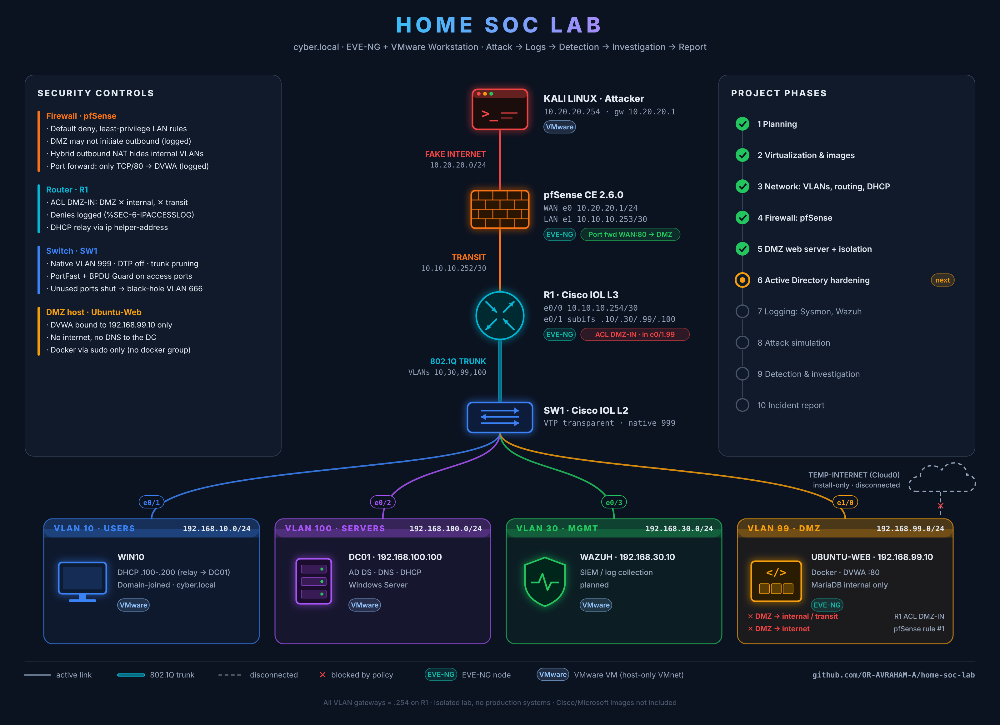

# Home SOC Lab

A home lab that simulates a small enterprise network (`cyber.local`). I use it to practice the full cycle: **attack → logs → detection → investigation → incident report**.

It's built in **EVE-NG** (Cisco IOL router and switch, pfSense) and **VMware Workstation** (Active Directory, a Windows client, Kali Linux, and a Wazuh SIEM).

> Status: 🚧 In progress. Network and firewall phases complete. DMZ web server (DVWA) is published to the attacker network and isolated from the inside.

---

## Architecture



| Segment       | VLAN | Subnet            | Gateway          | Hosts                          |
|---------------|------|-------------------|------------------|--------------------------------|
| Fake Internet | -    | 10.20.20.0/24     | -                | Kali (attacker), pfSense WAN   |
| Transit       | -    | 10.10.10.252/30   | -                | pfSense LAN `.253`, R1 `.254`  |
| Users         | 10   | 192.168.10.0/24   | 192.168.10.254   | WIN10 (DHCP `.100-.200`)       |
| Management    | 30   | 192.168.30.0/24   | 192.168.30.254   | Wazuh `.10`                    |
| DMZ           | 99   | 192.168.99.0/24   | 192.168.99.254   | Ubuntu-Web `.10`               |
| Servers       | 100  | 192.168.100.0/24  | 192.168.100.254  | DC01 `.100` (AD / DNS / DHCP)  |

More detail is in [docs/ip-plan.md](docs/ip-plan.md).

## Stack

| Component        | Technology                                          |
|------------------|-----------------------------------------------------|
| Virtualization   | VMware Workstation Pro + EVE-NG Community 6.2       |
| Routing          | Cisco IOL L3 15.7 (Router-on-a-Stick)               |
| Switching        | Cisco IOL L2 (802.1Q trunk, access ports)           |
| Firewall         | pfSense CE 2.6.0                                    |
| Identity         | Windows Server 2019 (AD DS, DNS, DHCP) `cyber.local`|
| Endpoint         | Windows 10 Enterprise (domain-joined)               |
| Attacker         | Kali Linux                                          |
| Web target       | Ubuntu 22.04 cloud image + Docker + DVWA (DMZ)      |
| SIEM             | Wazuh (planned)                                     |

## Project Phases

| # | Phase                         | Status       |
|---|-------------------------------|--------------|
| 1 | Planning                      | ✅ Done       |
| 2 | Virtualization & Images       | ✅ Done       |
| 3 | Network (VLANs, Routing, DHCP)| ✅ Done       |
| 4 | Firewall (pfSense)            | ✅ Done       |
| 5 | DMZ web server (DVWA) + DMZ isolation | ✅ Done       |
| 6 | Active Directory hardening    | 🔄 Next       |
| 7 | Logging (Sysmon, Wazuh)       | ⏳ Planned    |
| 8 | Attack simulation             | ⏳ Planned    |
| 9 | Detection & Investigation     | ⏳ Planned    |
| 10 | Incident Report              | ⏳ Planned    |

## Network Hardening Applied (so far)

- Native VLAN changed from 1 to an unused VLAN (999) to mitigate VLAN hopping (double tagging)
- DTP disabled on the trunk (`switchport nonegotiate`)
- Only the required VLANs are allowed on the trunk
- PortFast + BPDU Guard on all access ports
- Unused ports shut down and moved to a black-hole VLAN (666)
- VTP transparent mode
- DHCP is relayed via `ip helper-address`. The servers VLAN uses static IPs only.

## Firewall Policy (pfSense)

- Default deny: the "allow LAN to any" rule is disabled. Each allowed flow has its own rule.
- The DMZ may not initiate any outbound connection (logged).
- Users: web only (80, 443). DC01: DNS only. Management: HTTPS only.
- Hybrid outbound NAT hides all internal VLANs behind the WAN address.
- Details: [configs/pfSense.md](configs/pfSense.md), [docs/firewall-design.md](docs/firewall-design.md), [verification/phase4-firewall.md](verification/phase4-firewall.md)

## DMZ (Phase 5)

- Ubuntu-Web (`192.168.99.10`) runs DVWA in Docker, bound to the DMZ interface only.
- pfSense port forward publishes only TCP/80 (`WAN -> 192.168.99.10`), with logging on allowed traffic.
- R1 ACL `DMZ-IN` blocks the DMZ from starting connections to internal networks and to the firewall. pfSense blocks it from the internet. Both log.
- Details: [configs/ubuntu-web.md](configs/ubuntu-web.md), [docs/dmz-design.md](docs/dmz-design.md), [verification/phase5-dmz.md](verification/phase5-dmz.md)
- Problems I hit and how I solved them: [docs/troubleshooting-log.md](docs/troubleshooting-log.md)

## Known Risks

- Kali has a second adapter (VMware NAT) that bypasses pfSense. It is kept **disconnected** and enabled only for updates.
- Log time zones are not unified yet (planned NTP fix before the SIEM phase).
- Any internal VLAN can open SSH to the DMZ (planned: allow only from VLAN 30).
- pfSense is managed from the Users VLAN (planned: admin GUI reachable only from VLAN 30).
- pfSense CE 2.6.0 (2022) is outdated; newer CE releases exist. Acceptable in an isolated lab, but it would be patched in production.

## Repository Structure

```
home-soc-lab/
├── README.md
├── configs/          # Device configurations (R1, SW1, ...)
├── diagrams/         # Topology diagrams
├── docs/             # IP plan, design decisions
├── screenshots/      # GUI evidence per phase (no credentials)
└── verification/     # Test outputs proving each phase works
```

## Disclaimer

Everything here runs in an isolated lab that I own. No real systems are targeted. Cisco and Microsoft images are **not** included in this repository.
